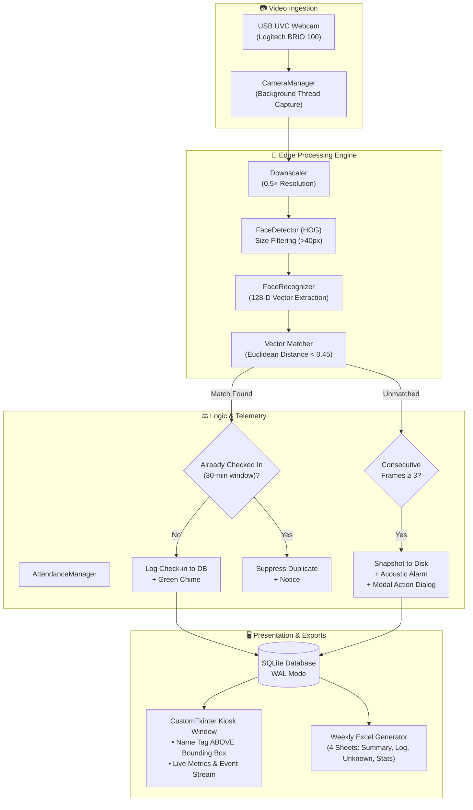
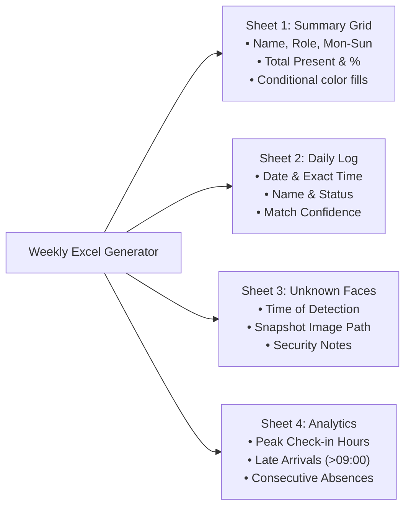

# APEX LAB — Face Recognition Attendance System
### Autonomous Edge AI Kiosk for Raspberry Pi 5 Model B

[](https://www.raspberrypi.com/products/raspberry-pi-5/)
[-A81D33?logo=debian&logoColor=white)](https://www.raspberrypi.com/software/)
[](https://www.python.org/)
[-007ACC)](https://customtkinter.tomschimansky.com/)
[](https://openpyxl.readthedocs.io/)
[](LICENSE)

An intelligent, self-contained face recognition attendance kiosk designed and optimized specifically for the **Raspberry Pi 5 Model B**. It captures continuous webcam video, performs real-time edge face detection and 128-dimensional biometric vector matching, displays a cyber-glassmorphic HUD with the subject's name rendered strictly above the detection square, enforces duplicate check-in suppression, logs unknown intruder snapshots, and automatically compiles weekly 4-sheet formatted Excel attendance workbooks.

---

## Table of Contents
- [1. System Architecture](#1-system-architecture)
- [2. Hardware Specifications & BOM](#2-hardware-specifications--bom)
- [3. Key Capabilities](#3-key-capabilities)
- [4. UI Design Philosophy — The Glass Panel](#4-ui-design-philosophy--the-glass-panel)
- [5. Automated Weekly Excel Reporting](#5-automated-weekly-excel-reporting)
- [6. Security Alert & Unknown Face Protocol](#6-security-alert--unknown-face-protocol)
- [7. Complete Raspberry Pi 5 Setup Guide](#7-complete-raspberry-pi-5-setup-guide)
- [8. Project File Structure](#8-project-file-structure)
- [9. Configuration Options](#9-configuration-options)
- [10. Usage & Command Reference](#10-usage--command-reference)
- [11. Autostart on Boot (Systemd Service)](#11-autostart-on-boot-systemd-service)

---

## 1. System Architecture



---

## 2. Hardware Specifications & BOM

| Component | Recommended Specification | Function on Raspberry Pi 5 |
| :--- | :--- | :--- |
| **SBC** | **Raspberry Pi 5 Model B (8GB RAM)** | Broadcom BCM2712 Quad-Core Cortex-A76 @ 2.4 GHz. Provides ~2.5× to 3× vector arithmetic throughput compared to RPi 4. |
| **Cooler** | **Official Raspberry Pi Active Cooler** | **Crucial.** Keeps temperature below 60°C under continuous ML inference and prevents thermal throttling. |
| **Webcam** | **Logitech C270 / C920 / C922 (USB UVC)** | 720p/1080p @ 30 FPS. Connect to the blue USB 3.0 ports for lowest latency. |
| **Power Supply** | **Official 27W USB-C (5.1V / 5.0A)** | Ensures stable 5A current delivery to USB peripherals and high-load CPU states. |
| **Storage** | **64GB+ A2 MicroSD or USB 3.0 NVMe SSD** | High IOPS for fast SQLite logging and snapshot image writes. |
| **Display** | **Official 7″ DSI Touchscreen or HDMI Monitor** | 1280×720 or 1920×1080 kiosk terminal screen. |

---

## 3. Key Capabilities

1. **Non-Occluding Face Tracking HUD**:
   - Computes facial bounding boxes with sleek corner bracket styling.
   - Renders the subject's name tag and confidence rating (e.g. `ALEX MERCER [98%]`) **strictly ABOVE the detection square**, ensuring the face is never obscured.
2. **Decoupled Video Pipeline**:
   - Capture runs on a dedicated background thread at ~30 FPS for buttery smooth display.
   - Inference runs every $N$-th frame (`RECOGNITION_INTERVAL = 3`) on a downscaled representation (`PROCESS_SCALE = 0.5`), keeping CPU load low and temperature stable.
3. **Smart Duplicate Prevention**:
   - `DUPLICATE_WINDOW_MINUTES = 30` prevents members who linger in front of the kiosk from filling the database with repeated entries.
4. **Multi-Angle Face Enrollment**:
   - Captures 3 to 5 face angles per individual (front, slight left, slight right, glasses on/off) directly from the kiosk interface to maintain >95% accuracy under varying angles.
5. **Acoustic Audio Feedback**:
   - Built-in sound synthesizer produces pleasant confirmation chimes on check-in, warning chords on unknown subjects, and success chords on registration.

---

## 4. UI Design Philosophy — The Glass Panel

Unlike standard, generic interfaces, the UI is styled as a **Dark Cyber-Glassmorphism Kiosk**:

```
┌─────────────────────────────────────────────────────────────────────────────┐
│ ┌──────────────────────────────────────┐  ┌───────────────────────────────┐ │
│ │                                      │  │ APEX LAB        ● LIVE MONITOR │ │
│ │   CAMERA FEED                        │  ├───────────────────────────────┤ │
│ │                                      │  │ LAST RECOGNIZED SUBJECT       │ │
│ │          ┌──────────────────────┐    │  │ 👤 ALEX MERCER                 │ │
│ │          │ ALEX MERCER [98%]    │    │  │ ROLE: MEMBER      TIME: 09:02 │ │
│ │          ├──────────────────────┤    │  │ [✔ CHECKED IN (98%)]          │ │
│ │          │                      │    │  ├───────────────────────────────┤ │
│ │          │      😊 Face         │    │  │ PRESENT    ABSENT   UNKNOWN   │ │
│ │          │                      │    │  │   14         2        1       │ │
│ │          └──────────────────────┘    │  ├───────────────────────────────┤ │
│ │                                      │  │ LIVE CHECK-IN FEED            │ │
│ │                                      │  │ ● Alex Mercer     09:02:14    │ │
│ │                                      │  │ ● Sarah Connor    09:01:05    │ │
│ └──────────────────────────────────────┘  │ ➕ Register Face              │ │
│                                           │ 📊 Export Excel Report        │ │
│ ┌───────────────────────────────────────┐ └───────────────────────────────┘ │
│ │ ● RASPBERRY PI 5 — CORE INFERENCE ACTIVE      Wed 29 Oct | 09:02:45 AM  │ │
│ └─────────────────────────────────────────────────────────────────────────┘ │
└─────────────────────────────────────────────────────────────────────────────┘
```

- **Obsidian Dark Palette**: `#0B0F19` base with translucent `#111827` panels and `#374151` borders.
- **Color-Coded Status**: Neon Emerald (`#10B981`) for match, Warm Amber (`#F59E0B`) for duplicates/processing, and Crimson (`#EF4444`) for unregistered alerts.

---

## 5. Automated Weekly Excel Reporting

The system includes an automated Excel report engine (`reports/excel_generator.py`) using `openpyxl`. It automatically compiles and formats four detailed sheets:



### Automation Schedule
- Configured by default in `config.py` to compile every **Sunday at 23:59**.
- Can also be exported on-demand at any time with a single click in the UI or via CLI:
  ```bash
  python scripts/generate_report.py --start 2026-10-22 --end 2026-10-29
  ```

---

## 6. Security Alert & Unknown Face Protocol

When an unregistered subject appears before the camera:
1. The system tracks consecutive unidentified frames.
2. When `CONSECUTIVE_UNKNOWN_THRESHOLD` (default: `3`) is reached:
   - A high-resolution frame snapshot is saved to `data/unknown_captures/unknown_YYYYMMDD_HHMMSS.jpg`.
   - An acoustic alarm tone plays.
   - An incident record is written to the `attendance_log` table with status `unknown`.
   - A modal dialog appears on screen displaying the snapshot and three action paths:
     - **👤 Register Person Now**: Immediately opens guided multi-angle face enrollment.
     - **🏷️ Log as Temporary Visitor**: Records them as a visitor for today.
     - **Dismiss Alert**: Clears the alert.

---

## 7. Complete Raspberry Pi 5 Setup Guide

Follow these steps to set up a brand new Raspberry Pi 5 running **Raspberry Pi OS (64-bit Bookworm)**:

### Step 1: Install System Dependencies
```bash
sudo apt update && sudo apt upgrade -y
sudo apt install -y python3-pip python3-dev python3-venv build-essential cmake \
                    libopenblas-dev liblapack-dev libjpeg-dev zlib1g-dev \
                    libatlas-base-dev libavcodec-dev libavformat-dev libswscale-dev \
                    libv4l-dev libxvidcore-dev libx264-dev libgtk-3-dev \
                    python3-pil.imagetk v4l-utils
```

### Step 2: Clone and Setup Python Virtual Environment
```bash
cd ~
git clone https://github.com/aarav22728-sudo/Attendance_system_APEX_LAB.git APEX_LAB_attendance
cd APEX_LAB_attendance

# Create venv with system site-packages (recommended on Debian Bookworm)
python3 -m venv --system-site-packages venv
source venv/bin/activate

# Install Python packages
pip install -r requirements.txt
```

### Step 3: Verify Webcam
```bash
v4l2-ctl --list-devices
```
Ensure your webcam appears as `/dev/video0`. If it appears on another index (e.g. `/dev/video1`), edit `config.py` or run `python main.py --cam 1`.

---

## 8. Project File Structure

```
APEX_LAB_attendance/
├── main.py                     # Application entrypoint & background scheduler
├── config.py                   # Global system constants & tuneable thresholds
├── requirements.txt            # Python dependencies
├── README.md                   # Full system documentation
├── push_to_github.bat          # 1-Click Windows GitHub sync utility
│
├── core/
│   ├── camera.py               # Multithreaded camera capture
│   ├── detector.py             # FaceDetector (HOG / CNN with size filter)
│   ├── recognizer.py           # FaceRecognizer (128-D vector distance comparison)
│   └── attendance.py           # Attendance rules, duplicate & alert tracking
│
├── database/
│   ├── db_manager.py           # Thread-safe SQLite manager with WAL mode
│   ├── models.py               # Person, FaceEncoding, AttendanceRecord dataclasses
│   └── apex_lab.db             # Local SQLite database file
│
├── ui/
│   ├── app.py                  # Primary CustomTkinter Kiosk controller
│   ├── themes/
│   │   └── glassmorphism.py    # Theme palette, fonts & status styling
│   └── components/
│       ├── camera_feed.py      # Video widget + HUD overlay above detection square
│       ├── status_panel.py     # Live metrics, subject card & event stream
│       ├── alert_dialog.py     # Unknown subject alert with snapshot preview
│       └── enrollment.py       # Multi-angle face registration dialog
│
├── reports/
│   ├── excel_generator.py      # Automated 4-sheet weekly Excel workbook generator
│   └── exports/                # Output directory for generated .xlsx reports
│
├── scripts/
│   ├── enroll_person.py        # CLI personnel enrollment
│   ├── generate_report.py      # Manual Excel report generator
│   ├── benchmark.py            # Hardware latency and FPS benchmark tester
│   └── generate_assets.py      # Synthesizes audio feedback tones
│
└── assets/sounds/              # Chime, alert, and enrollment feedback audio
```

---

## 9. Configuration Options

All settings are centralized in [`config.py`](file:///c:/Users/APEX%20LAB/Downloads/APEX_LAB_attendance/config.py):

| Variable | Default | Description |
| :--- | :--- | :--- |
| `CAMERA_INDEX` | `0` | USB webcam device index |
| `CAMERA_WIDTH` / `HEIGHT` | `640` / `480` | Capture resolution |
| `PROCESS_SCALE` | `0.5` | Downscale ratio for face processing (0.5 = 2× faster) |
| `DETECTION_MODEL` | `"hog"` | `"hog"` (CPU-fast) or `"cnn"` (GPU-heavy) |
| `MATCH_TOLERANCE` | `0.45` | Stricter matching threshold (lower = stricter) |
| `DUPLICATE_WINDOW_MINUTES`| `30` | Minutes to ignore duplicate passes from same person |
| `CONSECUTIVE_UNKNOWN_THRESHOLD`| `3` | Unidentified frames before triggering alert |
| `REPORT_DAY` / `TIME` | `"sunday"` / `"23:59"`| Scheduled time to compile weekly Excel report |

---

## 10. Usage & Command Reference

### Launch Desktop Kiosk
```bash
# Standard resizable window
python main.py

# Fullscreen Kiosk Mode (for dedicated Raspberry Pi screens)
python main.py --kiosk
```

### CLI Face Enrollment (Without GUI)
```bash
python scripts/enroll_person.py
```
*Follow on-screen instructions: Press `SPACE` to capture 5 face angles, then `Q` to finalize.*

### Manual Report Generation
```bash
# Generate report for last 7 days
python scripts/generate_report.py

# Custom date range
python scripts/generate_report.py --start 2026-10-01 --end 2026-10-08
```

### Hardware Performance Benchmark
```bash
python scripts/benchmark.py
```
*Measures actual FPS, frame latency, and CPU usage on your Raspberry Pi 5.*

---

## 11. Autostart on Boot (Systemd Service)

To turn your Raspberry Pi 5 into a fully autonomous, plug-and-play kiosk that launches automatically on power-up:

1. Create a systemd service file:
   ```bash
   sudo nano /etc/systemd/system/apex-attendance.service
   ```

2. Paste the following configuration (replace `pi` with your username if different):
   ```ini
   [Unit]
   Description=APEX LAB Attendance Kiosk
   After=graphical.target

   [Service]
   Environment=DISPLAY=:0
   Environment=XAUTHORITY=/home/pi/.Xauthority
   Type=simple
   User=pi
   WorkingDirectory=/home/pi/APEX_LAB_attendance
   ExecStart=/home/pi/APEX_LAB_attendance/venv/bin/python main.py --kiosk
   Restart=always
   RestartSec=5

   [Install]
   WantedBy=graphical.target
   ```

3. Enable and activate the service:
   ```bash
   sudo systemctl daemon-reload
   sudo systemctl enable apex-attendance.service
   sudo systemctl start apex-attendance.service
   ```

---

## License
Developed for the **APEX LAB** project. Released under the [MIT License](LICENSE).

